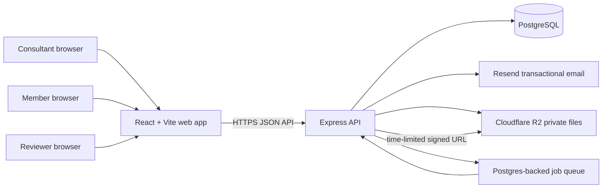

# Leadership DNA: group assessment and report workflow

## Purpose and scope

Build a multi-tenant application for leadership consultants. A consultant creates a client engagement (called a group), invites its individual members, assigns one or more private forms, reviews individual responses, creates a group report, and shares a fixed version of that report with one designated reviewer.

The core confidentiality rule is: a member can see and submit only their own assignments and their own responses. A consultant can see the responses for groups they own. A reviewer can see only the exact report version shared with them; they cannot see the group roster, raw responses, or the consultant's notes.

This plan extends the existing React + Vite frontend, Express API, Prisma, PostgreSQL, TipTap report editor, and Docker Compose setup. Keep the current report editor and content library. Do not introduce a general-purpose form SaaS or a paid form-builder plugin in the first release.

## Product decisions

Use these terms consistently in code and UI:

- **Consultant**: the paying account owner. Creates groups, forms, reports, invitations, and review shares.
- **Group**: a single client engagement or cohort. It has a name, optional client name, members, form assignments, and reports.
- **Member**: an invited person in a group. Has a normal login and can access only their own assigned forms and submitted answers.
- **Form template**: a reusable consultant-owned question set.
- **Form assignment**: an immutable snapshot of a form template assigned to all or selected group members. Editing the template later must not change an in-progress assignment.
- **Response**: one member's answers for one assignment. Draft answers are private to that member; submitted answers are visible to the consultant.
- **Report version**: an immutable snapshot of a report document. Sharing always points to a version, never to the editable report.
- **Reviewer**: a person invited to review one report version. A reviewer may comment, request changes, or approve, but cannot see raw responses.

## Architecture



Deploy the React build and API as a single Docker deployment initially. The current Nginx container already proxies `/api`, which avoids cross-origin cookie and CORS complexity. PostgreSQL remains the source of truth. Use R2 only for logos, optional form uploads, and generated PDFs; never make participant response files public.

### Authorization model

Authorization is enforced in the API, not merely hidden in the UI. Every data query must begin with one of these scopes:

| Actor | Allowed scope |
| --- | --- |
| Consultant | `group.consultantId = currentUser.id` |
| Member | `groupMember.userId = currentUser.id` and `groupMember.status = ACTIVE` |
| Reviewer | a valid, unexpired review grant for the requested immutable `reportVersionId` |

Never accept `userId`, `memberId`, `groupId`, or ownership flags from the client as proof of permission. Look up the target record, apply the actor scope in the same database query, and return `404` for objects outside that scope. This prevents user enumeration and insecure direct-object references.

### Authentication

Keep the current bcrypt password hashes and JWT structure for the first build. Add short-lived, single-use, hashed invitation and password-reset tokens. Store only the hash of every invite/share token; send the raw token only in the email URL.

Set access tokens to a short expiry (for example, 30 minutes) and add a server-side `Session` table for refresh-token rotation and logout. Use `HttpOnly`, `Secure`, `SameSite=Lax` cookies in production. Since the UI and API are same-origin, this is simpler and safer than storing tokens in `localStorage`. Add CSRF protection for state-changing cookie-authenticated endpoints.

## Data model

Replace the current single-owner report model gradually with the following Prisma models. Preserve existing `User`, `ContentBlock`, `Report`, `ReportBlock`, and historical `ReportDelivery` data via additive migrations and backfills.

```text
User
  id, email, name, passwordHash, createdAt, disabledAt

Group
  id, consultantId -> User, name, clientName?, status, createdAt, archivedAt?

GroupMember
  id, groupId -> Group, userId -> User?, email, displayName,
  role = MEMBER, status = INVITED | ACTIVE | REMOVED,
  invitedAt, joinedAt, removedAt
  unique(groupId, email)

FormTemplate
  id, consultantId -> User, title, description?, schema Json,
  version Int, archivedAt?, createdAt, updatedAt

FormAssignment
  id, groupId -> Group, templateId -> FormTemplate?, title,
  schemaSnapshot Json, version, status = DRAFT | OPEN | CLOSED,
  dueAt?, createdAt, publishedAt?, closedAt?

FormAssignmentRecipient
  id, assignmentId -> FormAssignment, groupMemberId -> GroupMember,
  status = NOT_STARTED | IN_PROGRESS | SUBMITTED,
  openedAt?, submittedAt?
  unique(assignmentId, groupMemberId)

FormResponse
  id, assignmentRecipientId -> FormAssignmentRecipient,
  answers Json, status = DRAFT | SUBMITTED,
  startedAt?, submittedAt?, updatedAt
  unique(assignmentRecipientId)

Report
  add groupId -> Group?, title, document Json?, documentStyle Json?,
  status = DRAFT | READY | SHARED | APPROVED, currentVersionId?

ReportVersion
  id, reportId -> Report, number, title, document Json, documentStyle Json?,
  createdById -> User, createdAt, contentHash
  unique(reportId, number)

ReportReviewGrant
  id, reportVersionId -> ReportVersion, reviewerUserId -> User?,
  reviewerEmail, tokenHash, expiresAt, status = PENDING | CHANGES_REQUESTED | APPROVED | REVOKED,
  createdAt, openedAt?, decidedAt?, revokedAt?

ReportReviewComment
  id, grantId -> ReportReviewGrant, authorUserId -> User?, body,
  documentAnchor Json?, createdAt

InviteToken
  id, groupMemberId -> GroupMember, tokenHash, expiresAt, usedAt?, revokedAt?, createdAt

PasswordResetToken
  id, userId -> User, tokenHash, expiresAt, usedAt?, createdAt

AuditEvent
  id, actorUserId?, groupId?, type, targetType, targetId,
  metadata Json, createdAt
```

Use PostgreSQL foreign keys, explicit indexes on all foreign keys and common authorization filters (`Group.consultantId`, `GroupMember.userId`, `FormAssignment.groupId`, `Report.groupId`, `ReportReviewGrant.tokenHash`). Keep answers as `Json` for flexible early-stage forms. Do not use a JSON field for ownership or access rules.

## Form format: affordable and intentionally constrained

Build a narrow form composer with React and plain JSON schema rather than buying a commercial white-label builder. Start with these field types:

- Short text and long text
- Single choice and multiple choice
- Rating scale (configurable labels and range)
- Yes/no
- Date
- Statement/instructions

Every question receives a stable opaque `id`; responses are keyed by that ID. A form schema contains `version`, `title`, `description`, `questions`, and basic display conditions. Validate the complete schema on the API using Zod. On submission, validate answers against the assignment's `schemaSnapshot`, never the mutable template.

Add these only after live use requires them: file upload, required-by-condition rules, calculated scores, branching, multilingual forms, anonymous mode, and visual drag-and-drop editing. Avoid SurveyJS Creator in the initial release: its form renderer is MIT, but Creator, PDF Generator, and Dashboard require commercial developer licenses. A small native composer keeps cost at $0 and fits this focused product. [SurveyJS licensing](https://surveyjs.io/licensing)

## Delivery plan

Each phase is independently deployable. Do not begin the next phase until the listed acceptance checks pass.

### Phase 0 — stabilize the existing foundation

1. Add a local `docs/` directory and move architecture and operational notes there as the app grows.
2. Add a production configuration validator that fails startup when `DATABASE_URL`, `JWT_SECRET`, `APP_ORIGIN`, email credentials, or storage credentials are missing or use development defaults.
3. Add structured request logging with request IDs, rate limits on login/register/reset endpoints, a restrictive CORS policy, and a production error handler that never exposes stack traces.
4. Add a global ownership helper for the existing content-library and report routes. Existing reports remain owned by their creator until they are attached to a group.
5. Add database backup documentation and a restore rehearsal. Test migration deployment against a disposable production-like database.

Acceptance: existing report and content-library tests pass; no production secret has a fallback default; API errors reveal no internal stack trace.

### Phase 1 — groups and member accounts

1. Add `Group`, `GroupMember`, and invitation-token migrations.
2. Consultant UI: group list; create, rename, archive; member table with invite status; add members by name and email; resend or revoke an invitation.
3. Invitation flow: email a one-time link; recipient sets their password; link activates the existing User record or joins the matching signed-in user; expired or used links cannot be reused.
4. Member dashboard: “My forms” and “My reports shared with me.” Do not show group roster or another member’s status.
5. Add a `requireConsultantGroup()` API helper and member-scoped loaders. Update every new route to use one of them.

Acceptance: a consultant can invite two members; each member can sign in and see only their own empty dashboard; attempting to read the other member’s group or invite returns `404`.

### Phase 2 — form templates, assignments, and confidential responses

1. Add the form-template, assignment, recipient, and response migrations.
2. Build a template editor. Templates are consultant-owned and reusable across groups.
3. On “publish assignment,” copy the template schema to `schemaSnapshot`, create recipient records, and send invitations. Allow assignment to all active members or selected members.
4. Member experience: accessible, mobile-friendly form; save draft; resume; submit; clear submitted confirmation. Submitted answers become read-only to the member unless the consultant reopens the assignment.
5. Consultant experience: group dashboard with response progress (`not started`, `in progress`, `submitted`), individual answers, and a CSV export limited to that group and assignment.
6. Build email reminders as a scheduled API job. A reminder is eligible only for an open assignment and an unsubmitted recipient; record a delivery event to prevent accidental duplicate sends.

Acceptance: changing a template after an assignment is published has no effect on its member form; a member cannot list or fetch another recipient’s response even if they guess its ID; consultant sees accurate group completion counts.

### Phase 3 — report workflow and analysis handoff

1. Add `groupId` to Report and link report creation to a group. Preserve existing standalone reports.
2. Add a group report workspace. It shows the current group’s assignments and submitted responses in a separate analysis panel next to the existing TipTap editor.
3. Keep analysis as consultant-authored in v1. Add safe insertion helpers for response values and aggregate values into report text; do not expose a raw response dump in a report by default.
4. Add report versions. “Prepare for review” freezes the current document and style into a new `ReportVersion`; editing later creates another version rather than changing a reviewed version.
5. Use the existing private facilitator notes only in the consultant workspace. They must never be copied into `ReportVersion` or PDF output.

Acceptance: reports link to exactly one group; version one remains byte-for-byte unchanged after editing and creating version two; a consultant can generate a report without exposing notes.

### Phase 4 — restricted reviewer sharing

1. Add report-review grants and comments.
2. Consultant selects one email address, an expiry date, and a report version. The app creates a hashed, revocable, single-purpose grant and sends it by email.
3. Reviewer flow: set a password or sign in via the invitation link; see the exact report version, comment, request changes, or approve. Do not show navigation to groups, forms, response data, or other reports.
4. Consultant sees reviewer state, comments, timestamped decisions, can revoke access, and can issue a new grant for a later report version.
5. Add a reviewer-safe HTML print view. PDF output belongs after the web review flow works reliably.

Acceptance: a reviewer with a valid grant can access only its report version; a revoked or expired link returns no report content; approval and request-change decisions are recorded in the audit log.

### Phase 5 — document output and operational hardening

1. Generate PDF server-side from a frozen report version. Use `@react-pdf/renderer` for predictable page layout and PDF creation; store the resulting file privately in R2. Never generate client PDFs from editable report state.
2. Add an R2 storage adapter using `@aws-sdk/client-s3` and presigned downloads. Limit MIME types and file sizes for optional uploads; scan uploads before enabling any public file-upload feature.
3. Add operational audit events for authentication, invitations, assignment publishing, response submission, report-share creation/revocation, and reviewer decisions. Audit logs must never contain answers, passwords, tokens, or report text.
4. Add data-retention settings per consultant: archive group, export group data, and request deletion. Define and document deletion behavior before selling the product.
5. Add a privacy policy, terms, consent text on forms, account deletion path, backup retention policy, and an incident contact address. Do not claim HIPAA compliance or anonymity without a separate technical and legal program.

Acceptance: a generated PDF matches the intended frozen version; all stored files require an authenticated/presigned URL; backup restore and export/deletion flows have been exercised in a nonproduction environment.

## API shape

Use REST because the existing API is REST. Validate every body with Zod and keep the paths group-scoped where possible.

```text
POST   /api/groups
GET    /api/groups
GET    /api/groups/:groupId
PATCH  /api/groups/:groupId
POST   /api/groups/:groupId/members
DELETE /api/groups/:groupId/members/:memberId
POST   /api/groups/:groupId/members/:memberId/invitations

POST   /api/form-templates
GET    /api/form-templates
PATCH  /api/form-templates/:templateId
POST   /api/groups/:groupId/assignments
POST   /api/assignments/:assignmentId/publish
POST   /api/assignments/:assignmentId/reminders

GET    /api/me/assignments
GET    /api/me/assignments/:assignmentId
PUT    /api/me/assignments/:assignmentId/response     # draft
POST   /api/me/assignments/:assignmentId/submit
GET    /api/groups/:groupId/assignments/:assignmentId/responses

POST   /api/groups/:groupId/reports
POST   /api/reports/:reportId/versions
POST   /api/reports/:reportId/review-grants
POST   /api/review/:token/activate
GET    /api/review/:token
POST   /api/review/:token/comments
POST   /api/review/:token/decision
DELETE /api/reports/:reportId/review-grants/:grantId
```

The raw token is permitted only on public activation/read endpoints. Once activated, exchange it for a reviewer session scoped to the grant. Never put review tokens in API logs, analytics, or error reports.

## Libraries and plugins

Keep the dependency footprint small. All cost estimates here are vendor list prices checked October 28, 2026; verify before purchasing.

| Need | Choice | Cost | Reason |
| --- | --- | ---: | --- |
| Current report editor | Existing TipTap open-source packages | $0 | Retain the editor already in the project. Do not add TipTap Cloud features; its paid platform starts at $49/month. [Tiptap pricing](https://tiptap.dev/pricing) |
| Form rendering / composer | Native React components + Zod | $0 | The supported question set is small and avoids commercial builder licensing. |
| Client form ergonomics | `react-hook-form` | $0 | Lightweight state and validation for the member form. [React Hook Form](https://react-hook-form.com/) |
| PDF output | `@react-pdf/renderer` | $0 | Server-side PDF from a frozen report snapshot. |
| Email | `resend` + `@react-email/components` | $0 to start | Resend free: 3,000 transactional emails/month, maximum 100/day. Pro: $20/month for 50,000. [Resend pricing](https://resend.com/pricing) |
| Background jobs | `pg-boss` | $0 | Uses the existing PostgreSQL database; no Redis bill for reminders and PDF jobs. |
| Object storage | Cloudflare R2 + `@aws-sdk/client-s3` | $0 to start | 10 GB/month and operations free; then $0.015/GB-month, with no egress charge. [R2 pricing](https://developers.cloudflare.com/r2/pricing/) |
| IDs/tokens | Node `crypto` | $0 | Use `randomBytes` and SHA-256 token hashes; no token library needed. |
| Passwords | Existing `bcryptjs` | $0 | Retain it; use a calibrated cost factor. |
| Payments | Defer to post-pilot; later Stripe Checkout + webhooks | usage-based | Do not build billing before customers validate the workflow. |
| Error tracking | Start with structured logs; later Sentry free tier if needed | $0 to start | Avoid collecting response content in telemetry. |

Do not use a paid plugin for e-signature, AI report writing, complex conditional forms, CRM integration, or a client portal in the pilot. They do not improve the core group-to-reviewed-report loop enough to justify cost or build complexity.

## Hosting and operating costs

### Recommended pilot deployment: managed and low-maintenance

Use Render Hobby for a single always-on API/web service and managed Postgres, Cloudflare R2 for private PDF/file storage, and Resend for email. Deploy from the Git repository with a `render.yaml` blueprint. Build the Vite web app as part of the API image, or retain the current two-container Compose design if using a Render private service for the API.

| Service | Pilot configuration | Estimated monthly cost |
| --- | --- | ---: |
| Render web/API | Starter, 0.5 CPU / 512 MB | about $7 |
| Render PostgreSQL | Basic, 256 MB | about $6 |
| Render database storage | small early dataset | $0.30/GB-month |
| Cloudflare R2 | under free allowance | $0 |
| Resend | under 3,000 transactional emails/month and 100/day | $0 |
| Domain name | `.com`, annual registration | roughly $1–2/month equivalent |
| Total before domain | | **about $13/month** |

Render states that the always-on Starter service plus Basic-256 MB Postgres typically costs about $13/month, before bandwidth and storage. Paid Postgres includes a three-day point-in-time recovery window on the Hobby workspace. [Render cost snapshot](https://render.com/articles/how-much-does-cloud-application-hosting-cost-for-small-businesses), [Render backups](https://render.com/docs/postgresql-backups)

Use the Render free tier only for demos. Its web services spin down after 15 minutes, free Postgres expires after 30 days, and it has no recovery capability. Those conditions are unsuitable for client response data. [Render free-tier limits](https://render.com/articles/how-much-does-cloud-application-hosting-cost-for-small-businesses)

### Lowest cash-cost option: self-hosted VPS

Run the existing Docker Compose stack on a single small VPS with Caddy for HTTPS and an off-server encrypted PostgreSQL backup. This can be cheaper in cash, but makes you responsible for OS patches, monitoring, backups, and recovery. Use it only if the operator is comfortable maintaining production Linux. Do not select a provider solely from historical prices: the currently listed low-cost Hetzner CX23 option is unavailable in the pricing page checked for this plan.

### Cost controls

- Keep PDFs and uploaded files out of Postgres.
- Use a single shared sending domain initially; do not buy per-consultant email domains.
- Send reminders in batches through `pg-boss`; use the Resend free quota during pilots.
- Generate a PDF only on explicit request or when sharing a report version.
- Start without a permanent worker. Run `pg-boss` in the API process at pilot scale; separate it only when report/PDF work affects request latency.
- Make a daily encrypted logical database backup to R2 or another independent provider before onboarding paying customers.

## Required tests

Add API tests first because confidentiality failures are the largest product risk.

1. A member cannot fetch, modify, export, or infer another member’s response, assignment recipient record, or invitation status.
2. A member cannot access a group roster, raw reports, or consultant content library.
3. A consultant cannot access another consultant’s group, forms, response data, reports, or review grants.
4. A reviewer can retrieve only the assigned immutable version and cannot call any group, member, response, or other-report endpoint.
5. Expired, used, altered, and revoked invitation/review tokens fail without disclosing the associated email or report.
6. A published assignment remains unchanged if its source template is later edited.
7. A submitted response is immutable to the member unless explicitly reopened by the consultant.
8. A report version remains unchanged after later report edits.
9. Private facilitator notes never appear in review HTML, PDF output, API response to a reviewer, or audit events.
10. Rate limiting applies to authentication, invite activation, and review-token endpoints.

Use the existing test approach with a disposable PostgreSQL schema for API tests. Add Playwright browser tests for invitation acceptance, member submission, consultant response viewing, and reviewer approval.

## First Codex implementation prompt

Use this as the next build instruction:

```text
Implement Phase 1 of PRODUCT_BUILD_PLAN.md in this repository. Preserve all existing report and content-library behavior. Add additive Prisma migrations for Group, GroupMember, and InviteToken; consultant group and member management UI; one-time email invitation support behind an EmailProvider interface with a development console provider; invite acceptance; and a member dashboard. Enforce ownership in Express routes, return 404 for inaccessible group data, and add API plus Playwright tests proving members cannot access another member’s data. Do not add paid services or modify deployment configuration yet. Run the relevant tests and report changed files and results.
```

After Phase 1 is accepted, run the same pattern for Phase 2, then Phase 3, Phase 4, and Phase 5. Keep each pull request or Codex turn focused on one phase or one clearly testable slice of a phase.
